# Screenshot tour

A visual walk-through of the event booking system. Everything shown is fictional demo data
(`npm run seed-demo`): the event "Example Radio Meeting 2027", callsigns `DEMO01`..`DEMO10` and `example.com` addresses.

The system has three parts, each with its own address and audience:

| Part | Address | Who uses it | Password |
|---|---|---|---|
| [Guest pages](#1-guest-pages) | `/` and `/?public=1` | Event participants | none |
| [Booking admin](#2-booking-admin) | `/?admin=1` | Everyone who handles bookings | `ADMIN_PASSWORD` |
| [Event setup](#3-event-setup) | `/?setup=1` | The one or two people who configure the event | `SETUP_PASSWORD` |

The admin password cannot change the event setup, so it can be given to the whole team. See the
[admin guide](../ADMIN-GUIDE.md) for step-by-step instructions.

---

## 1. Guest pages

What participants see. Guests can switch between the enabled languages at the top of every page.

### Booking form (`/`)

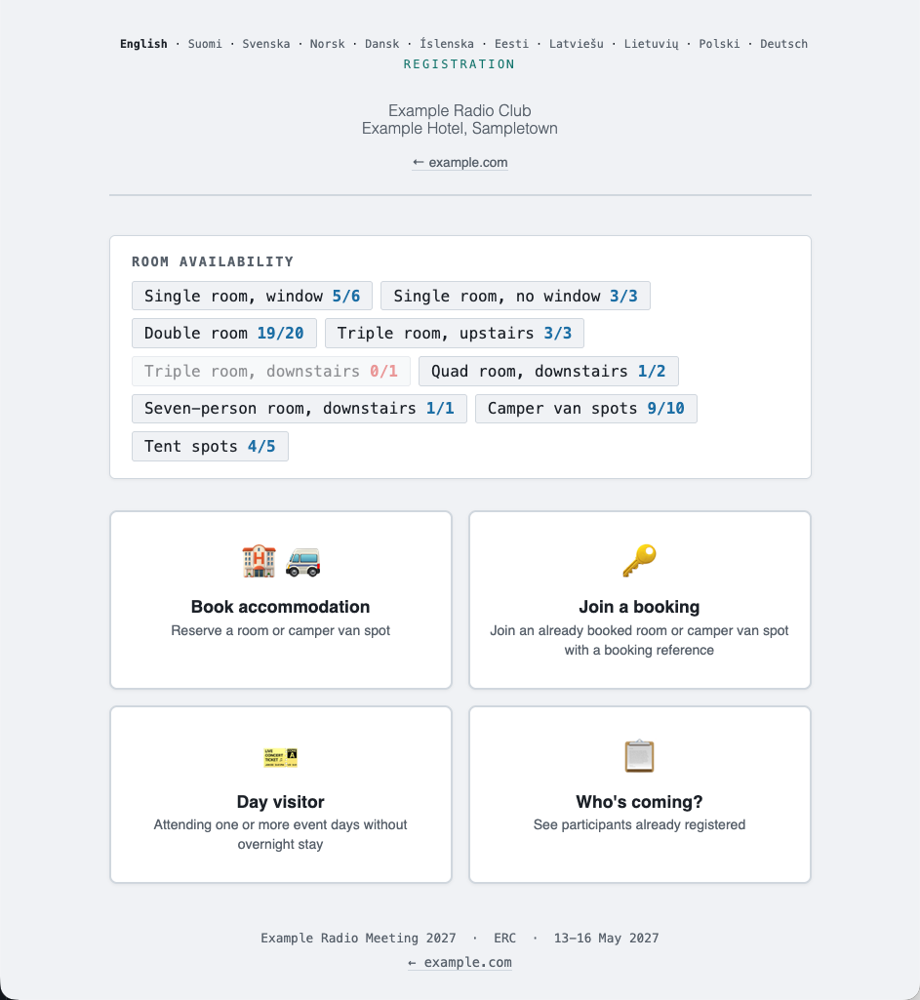

The front page. **Room availability** shows how many of each accommodation type are still free (a type that is fully
booked is greyed out). Below are the four things a guest can do: **Book accommodation** (a room or a camper van spot,
with tents and single beds when enabled), **Join a booking** (add yourself to an already booked room with the booking
reference), **Day visitor** (attend one or more event days without a stay) and **Who's coming?**. The header, colours and
texts come from [Event setup](#3-event-setup). The announcement banner, if one is set in the booking admin, appears at the top.

### Who's coming? (`/?public=1`)

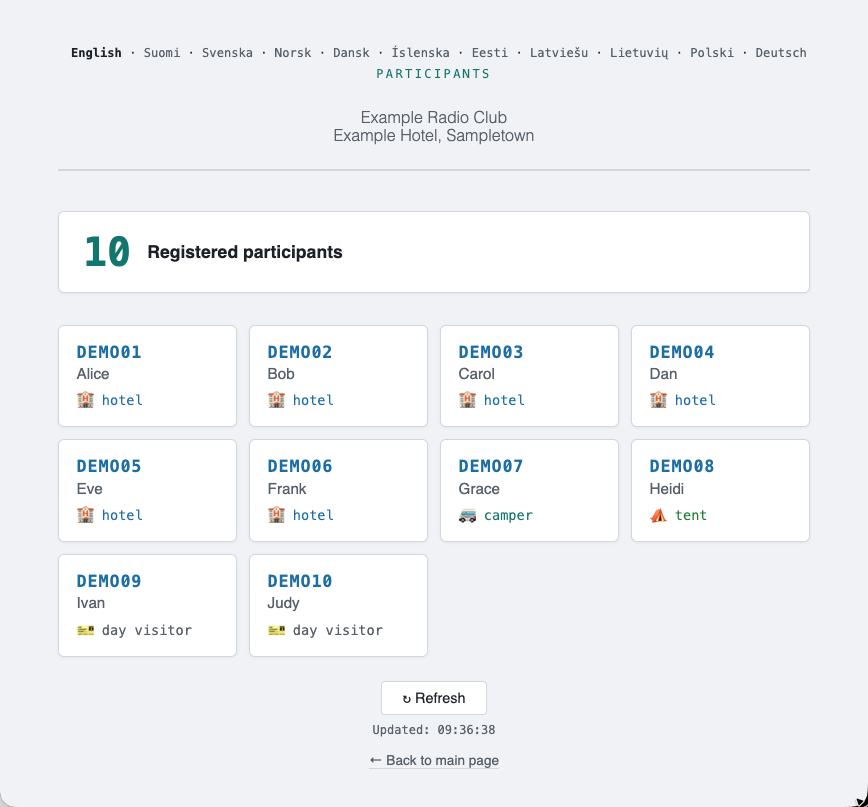

The public participant list. It shows only people who ticked the publish consent box when booking: callsign, first name
and the kind of stay (hotel, camper, tent, day visitor). No contact details are ever shown here.

---

## 2. Booking admin

For the team that runs registration day to day. Open `/?admin=1`. The header has a **Refresh** button (the page does not
update by itself) and a link to Event setup.

### Dashboard

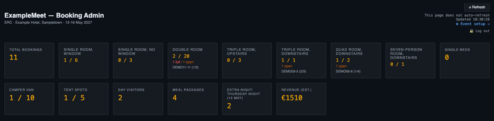

Live figures at the top of the page: total bookings, how many rooms of each type are booked out of the total (with a note
when a room still has an open bed or is full), single beds, camper van and tent spots, day visitors, meal packages, extra
nights and the estimated revenue in the event's native currency.

### Registration settings

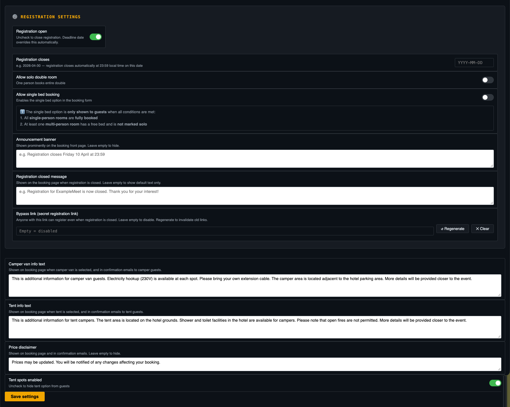

Everything that opens, closes or adjusts registration without touching the event setup:

- **Registration open** and **Registration closes** (an automatic closing date).
- **Allow solo double room** and **Allow single bed booking** switch the optional accommodation rules on and off.
- **Announcement banner** and **Registration closed message** are shown on the booking page.
- **Bypass link** is a secret link that lets selected people register after registration has closed. It can be regenerated or cleared.
- **Camper van info**, **Tent info** and **Price disclaimer** texts appear on the booking page and in the confirmation emails.
- **Tent spots enabled** hides the tent option from guests.

### Bookings table

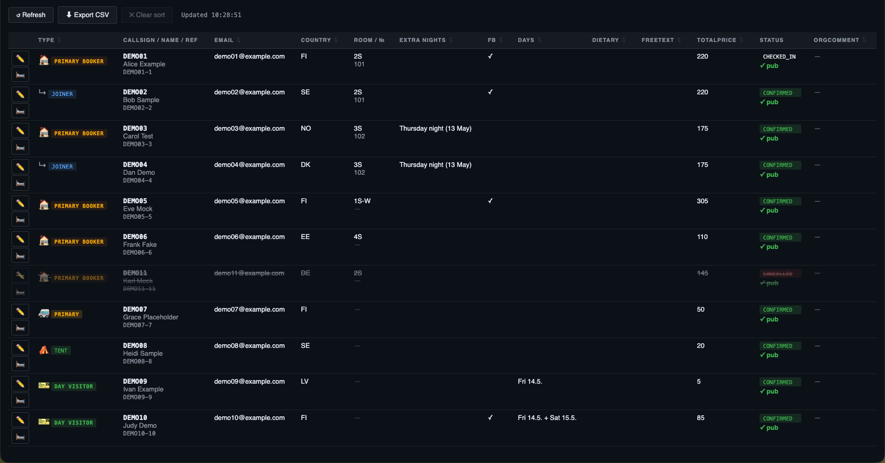

One row per booking. The type badge shows whether the person is the primary booker or a joiner of someone else's room,
or a camper, tent or day visitor. Shown per row: callsign, name and booking reference, email, country, room and room
number, extra nights, full board, visitor days, dietary needs, free text, total price, status (confirmed, checked in,
cancelled) and whether the guest agreed to be listed publicly. The pencil button edits a booking (including sending the
guest an updated confirmation and exporting or erasing one person's data on request), and the bed button changes the
accommodation, with the price difference calculated. Columns can be sorted, and **Export CSV** downloads the table.
Cancelled bookings stay in the list with strike-through so nothing disappears by accident.

---

## 3. Event setup

For the person who configures the event, normally once. Open `/?setup=1` with the setup password. Prices and room types
can be changed here without a code change, and everything is stored in the database.

### Event details

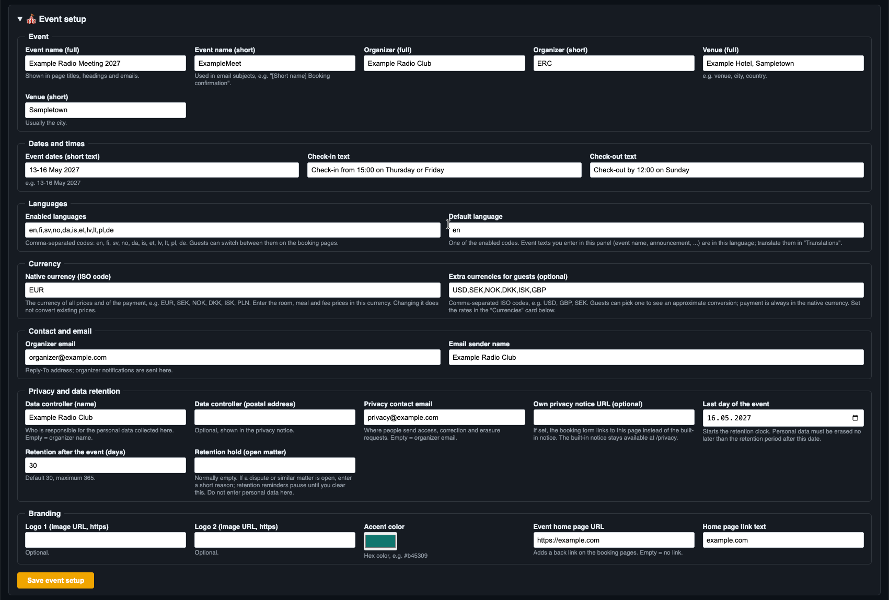

Identifies the event: names, organizer and venue, dates and check-in/out texts, **enabled languages** and the default
language, the **native currency** and optional extra display currencies, contact and sender email addresses, the data
controller and retention period for [GDPR](../GDPR.md), and branding (logos, accent colour, home page link). These values
are used on the booking pages, in emails, the privacy notice and the reports. Until the event setup is saved, visitors only
see a "not open yet" page.

### Currencies

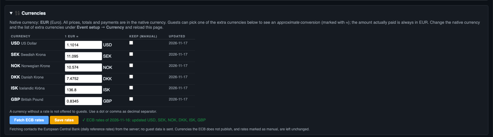

All prices and payments are in the native currency. Guests can pick one of the extra currencies to see an approximate
conversion (marked with ≈) while the amount they actually pay stays in the native currency. Rates are entered by hand or
fetched with **Fetch ECB rates** from the European Central Bank. A rate marked **Keep (manual)** is never overwritten
by a fetch. A currency without a rate is not offered to guests. See [CURRENCIES.md](../CURRENCIES.md).

### Event structure

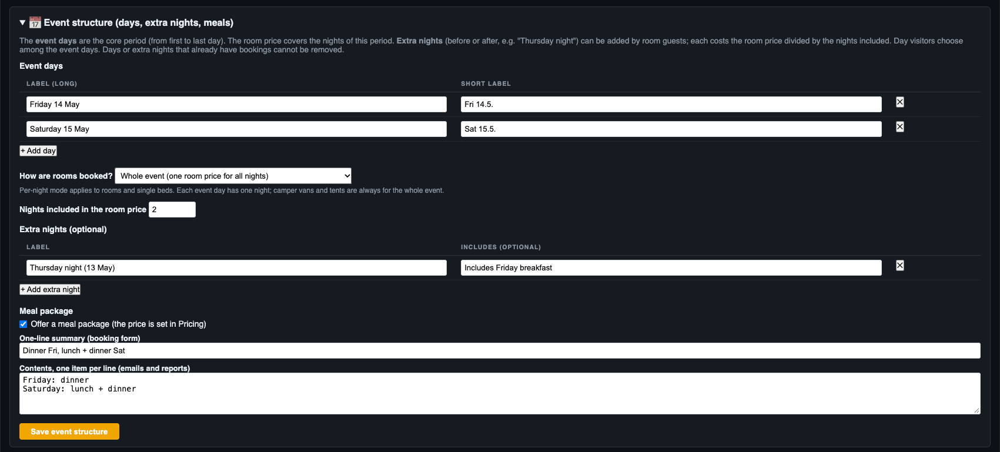

The shape of the event: the **event days**, how rooms are booked (the whole event with one price, or per night), how many
nights the room price includes, optional **extra nights** such as "Thursday night" that guests can add, and the **meal
package** with its description for the booking form, emails and reports. Days or extra nights that already have bookings
cannot be removed.

### Room types

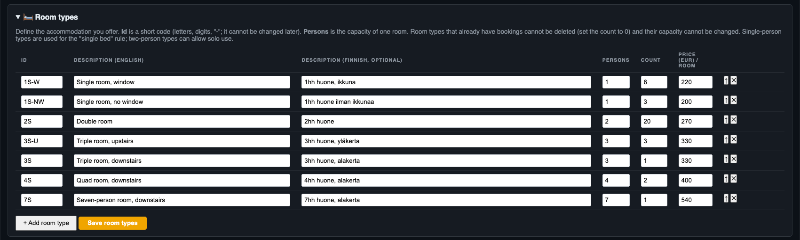

The accommodation you offer: a short id, description, number of persons per room, how many rooms exist and the price per
room. Room types that already have bookings cannot be deleted (set the count to 0 instead). Single-person types are used
by the single-bed rule and two-person types can allow solo use.

### Pricing and room inventory

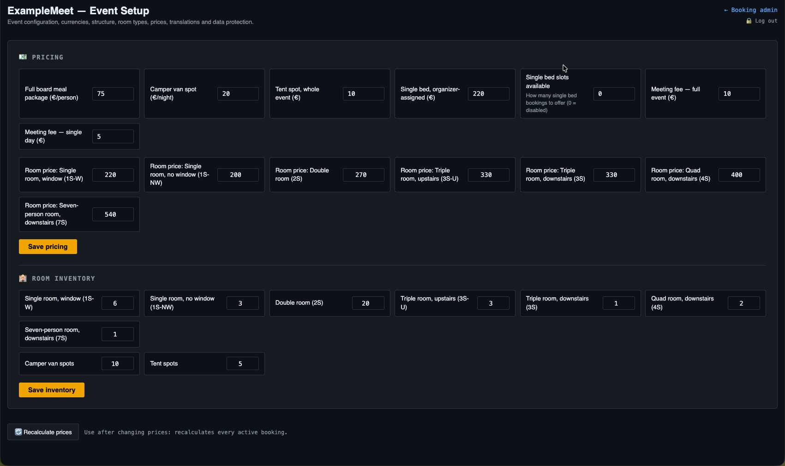

**Pricing** holds the prices outside the room catalogue (full board per person, camper van per night, tent spot, single
bed, meeting fee for the full event or a single day) and the room price overrides. **Room inventory** sets how many of each
room type, camper van spot and tent spot are available. **Recalculate prices** at the bottom applies new prices to every
active booking. Without it, changing a price affects only new bookings.

### Translations

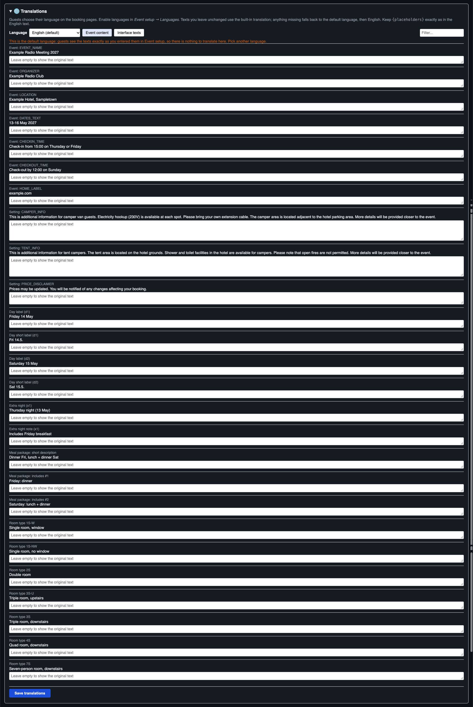

Everything you typed in Event setup, Event structure and Room types (event name, texts, day labels, room descriptions)
is listed here so it can be translated per language. An empty field means "show the original". The **Interface texts**
tab holds the built-in guest-facing texts and lets you override single sentences without editing code. See
[LANGUAGES.md](../LANGUAGES.md).

### Data protection and event shutdown

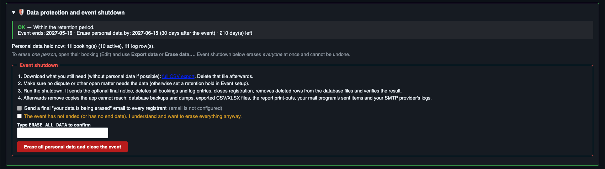

The GDPR tools. The status box shows when the retention period ends and the date by which personal data must be erased
(green when well inside the period, amber when close and red when overdue). **Event shutdown** is the "delete
everything" step after the event: it can send a final notice to every registrant, erases all bookings and logs, closes
registration and verifies the result. It asks for a typed confirmation and cannot be undone. Erasing a single person's data
is done from their booking in the booking admin. See [GDPR.md](../GDPR.md).

---

*How these screenshots were taken: see [SCREENSHOTS.md](../SCREENSHOTS.md).*
